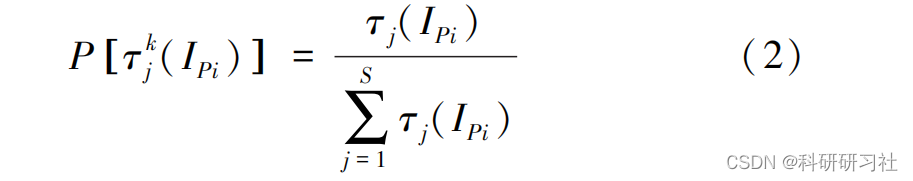
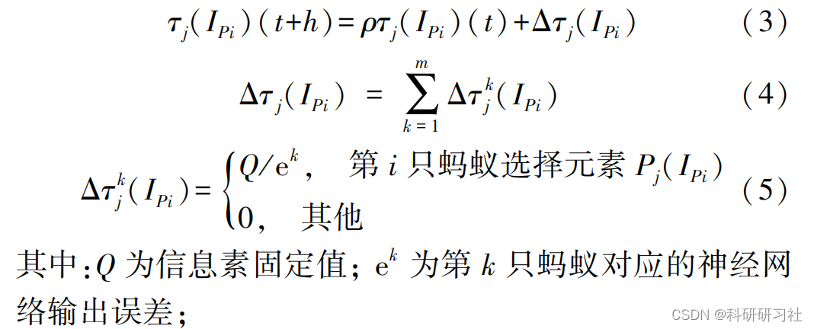
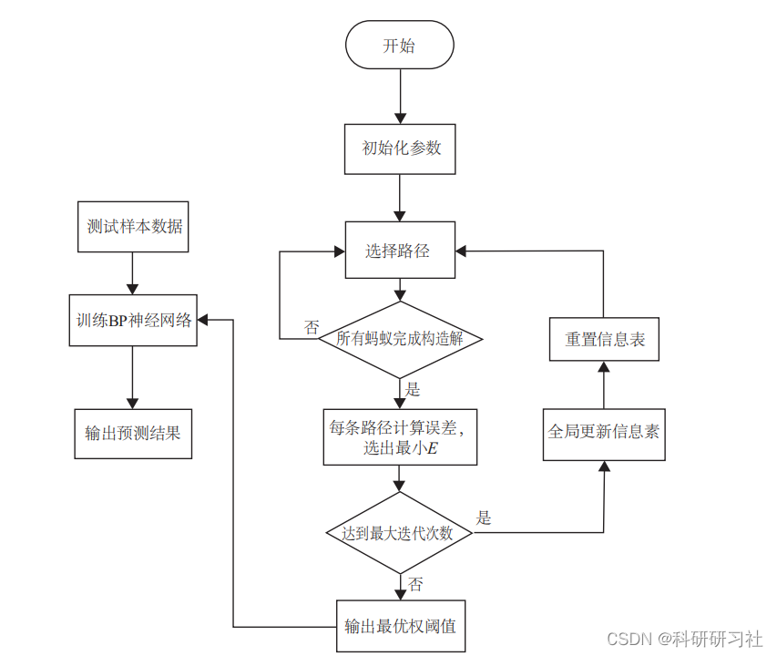
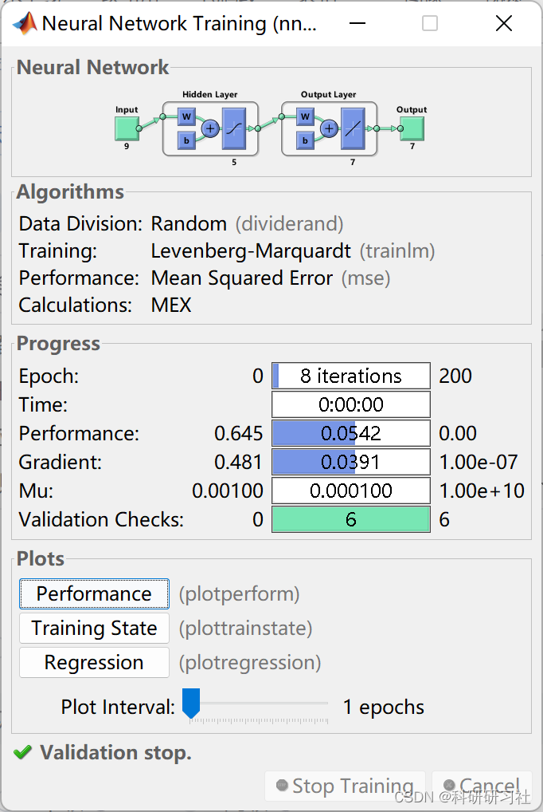
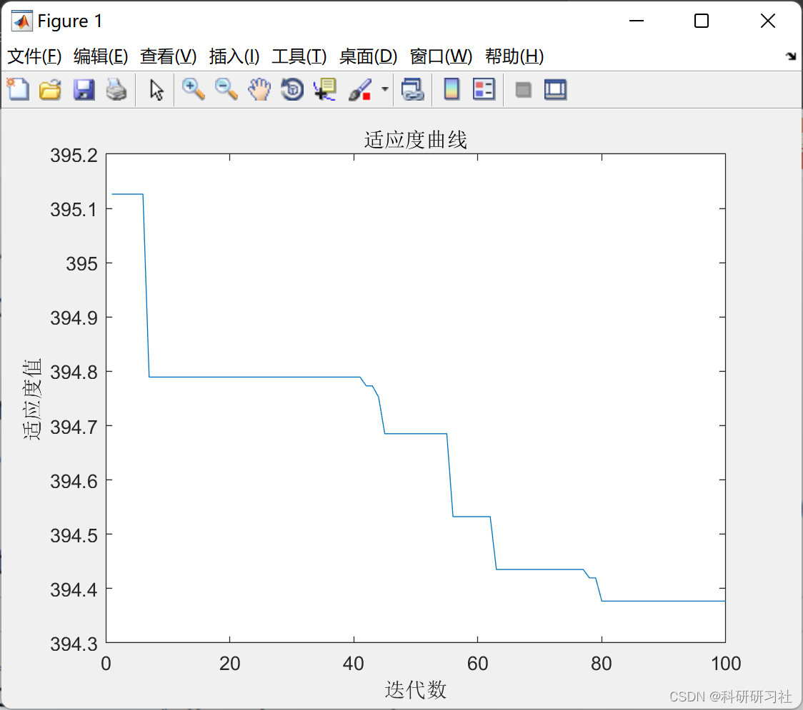
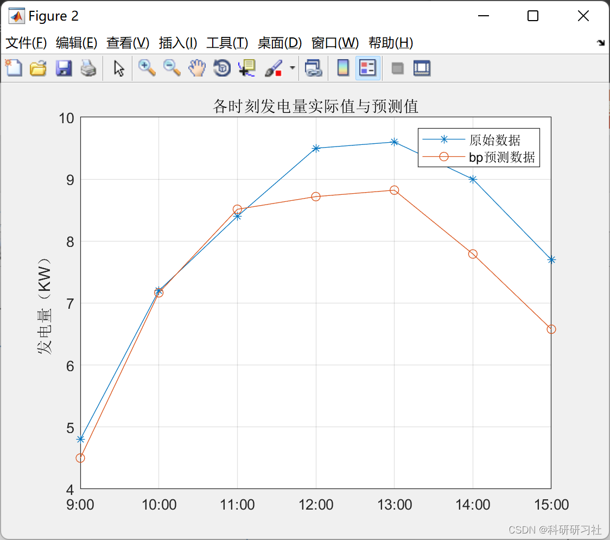

# [Load Forecasting] Application Research of BP Neural Network Based on Ant Optimization Algorithm in Load Forecasting (Matlab Complete Code)

0 Knowledge Review - Intelligent Optimization Algorithms - Ant Colony Algorithm (Python Implementation)
Based on the improved ant colony algorithm to solve shortest path problems, quadratic assignment problems, and knapsack problems [Matlab & Python code implementation]
Matlab | Short-term load forecasting for power systems based on BP neural network
1 ACO-BP Algorithm
The traditional BP neural network training uses the error backpropagation learning algorithm, which has a relatively complex optimization objective function and is prone to falling into local optima, slow convergence issues. Since the training algorithm of the BP neural network essentially involves iteratively adjusting its network weights and thresholds, using the ant colony optimization algorithm to replace the BP algorithm to complete the iterative adjustment of the neural network's weights and thresholds, and ultimately complete the training of the neural network.
2 Basic Approach of ACO-BP Algorithm
The basic idea of the ant colony algorithm in solving optimization problems is: Using the paths of ants as the feasible solutions of the problem to be optimized, and all paths of the entire ant colony constitute the solution space of the problem. The ants with shorter paths release more pheromone. After a certain time, the concentration of pheromone accumulates higher on the shorter paths, and as more ants choose these paths, they gradually increase. Finally, the entire ant colony will concentrate on the best path under positive feedback, which corresponds to the optimal solution of the problem to be optimized.
Firstly, according to the pool of values for weights and thresholds, divide the E into S equal-length intervals, that is, each interval is divided into S parts, and the critical value or random value in the interval is taken as a candidate value. Determine the number of parameters n, including all weights and thresholds in the network. Each parameter Pi (i = 1, 2, ..., n) corresponds to an S-element set l, where these elements are possible values for Pi.
3 Steps
1)Parameter initialization: Divide all weights and thresholds into S parts, initialize the initial pheromone O, residual pheromone coefficients into, after i generations, the previous interval information table is Tabu, maximum iteration count C, global network error E, maximum learning times N;
2) Selection of weights and thresholds: An ant colony consists of m ants, for each ant k, the selection of a node's interval is based on the pathfinding rule in equation (2), according to the probability formula. After one iteration of the ant colony, a solution is constructed:
Edit
In the formula, `edit` represents the information pheromone value of the jth element in the set `edit`;
3) Ant Colony Optimization Decision Making: The constructed solution obtained by an ant colony after one iteration is the group of solutions with the smallest error at that time. The error Ec is calculated, and if it meets the ant colony requirements, it moves to step 4), otherwise it moves to step 5).
4) Network Training: The optimal constructed solution obtained by the ant colony iterations is used as initial weights and thresholds, and the network is trained using the dataset until the end condition is met, i.e., the maximum number of learning times, completing the learning. Otherwise, continue learning;
5) Pheromone Update: According to equations (3), (4), and (5), all intervals' pheromones are updated globally, and the information table is reset:
Edit
6) Ant Colony Traversal: Repeat steps 2) to 3). The algorithm is shown in Figure 1.
Figure 1 ACO-BP algorithm flowchart
4) Matlab Code Implementation: This section only showcases part of the code, the complete code can be found in:
Application Research of BP Neural Network Based on Ant Optimization Algorithm in Load Forecasting (Matlab Complete Code Implementation)
Function [y, trace] = antforelm(inputnum, hiddennum, outputnum, net, inputn_train, label_train); % Ant Colony Optimization for Function Extrema
5. Running results
6. References
[1] Chen Zhiyu, Lu Jingui. Power generation forecasting of photovoltaic systems based on ACO-BP neural network [J]. Mechanical Manufacturing and Automation, 2020, 49(01): 173-175 + 187. DOI: 10.19344/j.cnki.issn1671-5276. 2020.01.047.

## Images

<!-- PAYMENT_BLOCK -->

## Get this dataset

- Payment link (Stripe): [Buy now](https://buy.stripe.com/3cs8yP7sY87d0vu9AB)
- Payment QR code: 

<!-- /PAYMENT_BLOCK -->
